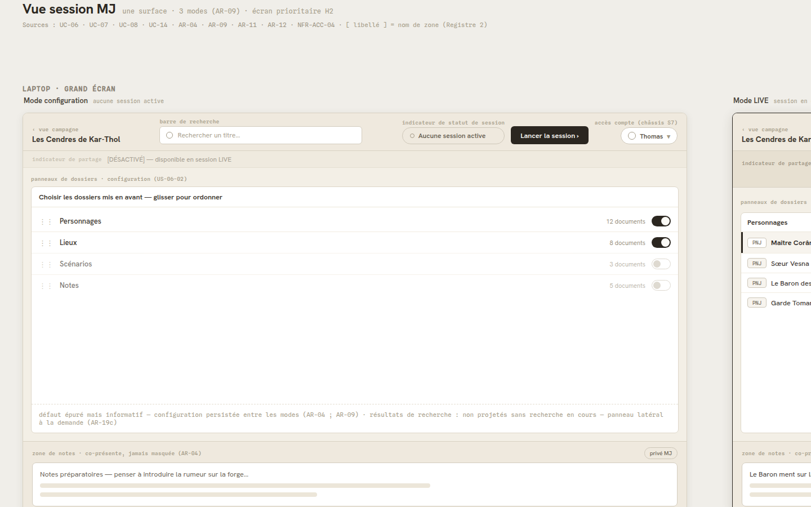

<div align="center">

# Haversack

**L'assistant du Maître du Jeu : préparer ses parties de jeu de rôle, les conduire, et partager avec ses joueurs ce qu'il choisit de leur montrer.**

[![Contrôles du corpus][badge-ci]][ci-runs]
[![Licence : tous droits réservés][badge-licence]](LICENSE)
[![Documentation en français][badge-docs]][site]

**Statut : conception rédigée et contrôlée, développement non commencé.**<br>
Quelques [décisions restent à prendre](docs/projet/decisions-en-attente.md) avant le premier jalon.

</div>

L'application n'est pas encore codée. Ce dépôt contient sa conception écrite (`docs/`, en français : besoin, écrans, architecture, plan de travail) et de petits outils C# qui vérifient la cohérence de ces documents (`tools/`).

**Le problème.** Le Maître du Jeu (MJ) jongle avec des scénarios, des fiches de personnages non joueurs, des notes secrètes et ce qu'il partage avec ses joueurs, éparpillés entre fichiers texte, Notion, Discord, papier et PDF. En pleine partie, il cherche, le rythme casse, des informations se perdent ([vision, § 1](docs/besoin/vision/vision.md#1-problème-utilisateur)).

**La réponse.** Un outil centré sur la préparation narrative et la conduite de la partie : ni table virtuelle, ni éditeur de texte générique ([vision, § 2](docs/besoin/vision/vision.md#2-positionnement)).

## Aperçu



*Maquette de la [vue session MJ](docs/interface/ecrans/sv-session/vue-session-mj/vue-session-mj.md). Les autres écrans sont dans l'[index des maquettes](docs/interface/ecrans/README.md).*

## En bref

- **Sans compte pour commencer** : le MJ ouvre l'application et écrit tout de suite ; ses données restent dans son navigateur.
- **Tout est document** : il note PNJ, lieux, scénarios et règles maison en blocs libres, et les range en dossiers, dans son espace personnel ou dans un espace de campagne.
- **Pendant la partie**, la vue session lui met sous la main ce qu'il a préparé et les dossiers qu'il a choisis.
- **Ses joueurs le rejoignent par un lien**, sans compte ; lui ne crée le sien que pour partager ou sauvegarder en ligne.
- **Convient à tous les systèmes de jeu** : Haversack ne gère ni les dés, ni les règles, ni les combats.

Ces choix et leurs raisons sont dans la [vision produit, § 2.2](docs/besoin/vision/vision.md#22-choix-produit-assumés).

**Pile prévue** : Angular, ASP.NET Core (C#), PostgreSQL et Entity Framework Core ([stack](docs/architecture/stack.md)), avec IndexedDB pour le mode sans compte et SignalR pour le temps réel ([roadmap de build, § 2](docs/projet/roadmap-de-build.md#2-vue-de-synthèse)).

## Feuille de route

| Étape | Ce qu'elle apporte |
|---|---|
| **J0** Socle | le squelette de l'application et un contrôle automatique de son architecture |
| **J1** Mode local | l'application utilisable sans compte, les données gardées dans le navigateur |
| **Décision de marché** | continuer ou non, selon l'usage réel du mode local |
| **J2** En ligne | le compte, la sauvegarde sur serveur et la reprise des données locales |
| **Validation juridique** | l'avis d'un juriste, nécessaire avant un lancement en Europe |
| **J3** Partage | les joueurs invités par un lien voient en direct ce que le MJ leur montre |

La roadmap de build est propriétaire de ce tableau : voir la [roadmap de build, § 2](docs/projet/roadmap-de-build.md#2-vue-de-synthèse).

## Démarrer

Rien à installer pour découvrir le projet :

1. lisez la [documentation en ligne][site], ou son point d'entrée dans le dépôt, [`docs/README.md`](docs/README.md), qui propose un parcours de lecture selon votre rôle ;
2. parcourez les [fiches et maquettes d'écran](docs/interface/ecrans/README.md).

## Structure du dépôt

```text
docs/                  conception du produit, en français
  besoin/              vision, personas, cas d'utilisation, stories, exigences non fonctionnelles
  domaine/             modèle métier par contexte : entités, règles, événements
  interface/           zonage, fiches d'écran et maquettes
  decisions/           décisions d'architecture (ADR)
  architecture/        pile, structure de la solution, spécifications techniques
  assurance/           sécurité, stratégie de test, conformité
  reference/           documents de synthèse, lisibles seuls
  projet/              roadmaps, plan de travail, risques, conventions
tools/                 outillage C# : contrôles du corpus et leurs tests
.github/workflows/     intégration continue
```

## Contribuer

Les contrôles du corpus tournent en intégration continue à chaque modification de `docs/` ou de `tools/`. Pour les lancer vous-même, et pour les règles de contribution, voir [`CONTRIBUTING.md`](CONTRIBUTING.md).

## Licence

Tous droits réservés : aucune reproduction, modification ni distribution sans autorisation écrite ; voir [`LICENSE`](LICENSE).

## Contact

Questions et signalements : [issues du dépôt][issues].

[ci-runs]: https://github.com/2025-10-CDA-ECO-P6/PM-micro-saas/actions/workflows/controles-corpus.yml
[badge-ci]: https://github.com/2025-10-CDA-ECO-P6/PM-micro-saas/actions/workflows/controles-corpus.yml/badge.svg
[issues]: https://github.com/2025-10-CDA-ECO-P6/PM-micro-saas/issues
[site]: https://2025-10-cda-eco-p6.github.io/PM-micro-saas/
[badge-licence]: https://img.shields.io/badge/licence-tous%20droits%20r%C3%A9serv%C3%A9s-lightgrey
[badge-docs]: https://img.shields.io/badge/documentation-fran%C3%A7ais-blue
