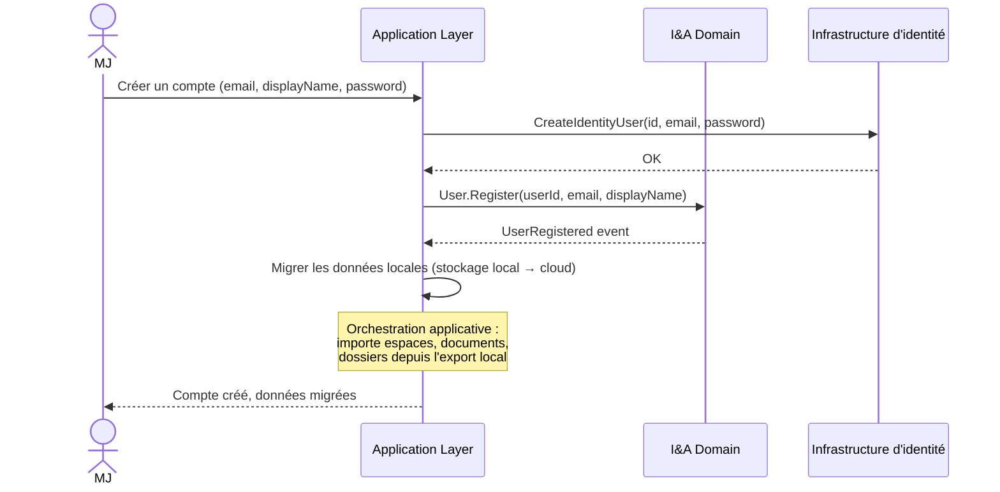
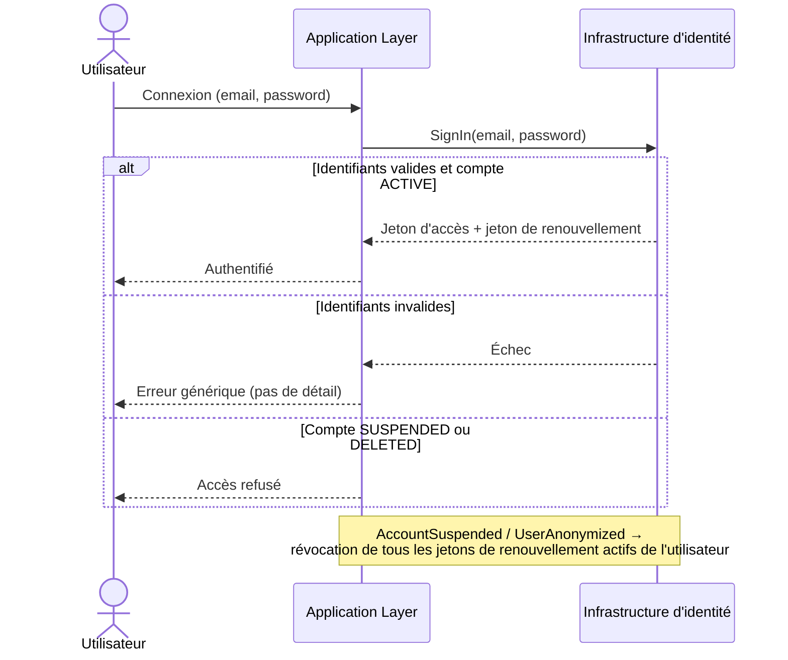
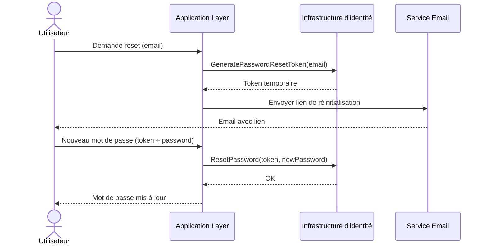
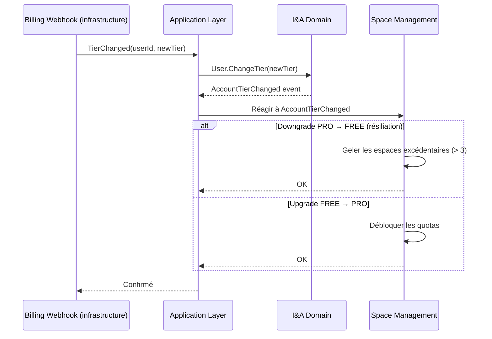
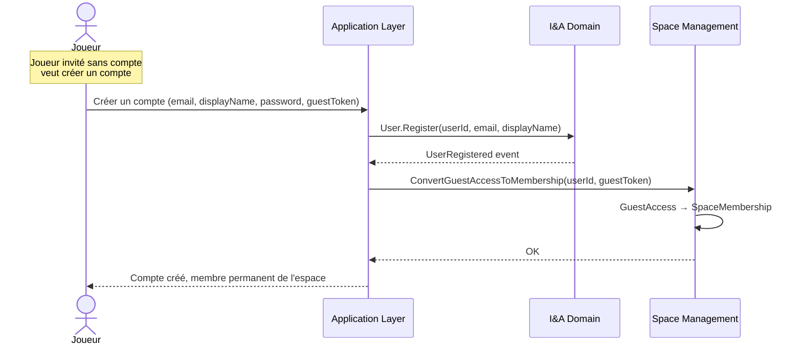

# Identity & Access — Diagrammes de flux

## Flux 1 — Inscription depuis le mode local



## Flux 2 — Connexion

> Durées de vie et révocation des jetons : voir [ADR-015](../../decisions/ADR-015-securite-authentification-mvp.md) § 3 et la [vue transverse de sécurité](../../architecture/transverse.md). La suspension et l'anonymisation du compte révoquent tous les jetons de renouvellement actifs de l'utilisateur.



## Flux 3 — Réinitialisation du mot de passe



## Flux 4 — Suppression de compte (RGPD)

```mermaid
sequenceDiagram
    actor Utilisateur
    participant App as Application Layer
    participant IA as I&A Domain
    participant SM as Space Management

    Utilisateur->>App: Supprimer mon compte
    App->>SM: GetBlockingSpaces(userId)
    Note over SM: Espaces CAMPAIGN/ONE_SHOT avec au moins<br/>un SpaceMembership actif autre que le propriétaire.<br/>PERSONAL n'est jamais bloquant (mono-membre, invariant 3 I&A).
    alt Espaces CAMPAIGN/ONE_SHOT bloquants
        SM-->>App: Liste des espaces bloquants
        App-->>Utilisateur: Bloqué — gérer les espaces d'abord
    else Aucun espace bloquant
        App->>IA: User.Delete()
        IA-->>App: UserDeleted event
        App->>IA: User.Anonymize()
        IA-->>App: UserAnonymized event
        App->>SM: Réagir à UserDeleted — routage par type d'espace :<br/>PERSONAL → hard-delete (saga SpaceDeleted) ;<br/>CAMPAIGN/ONE_SHOT restants → anonymiser member data
        App-->>Utilisateur: Compte supprimé, déconnecté
    end
```

## Flux 5 — Changement de tier (upgrade ou résiliation)



## Flux 6 — Conversion GuestAccess → User


