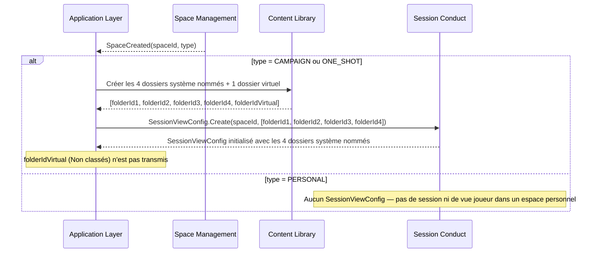
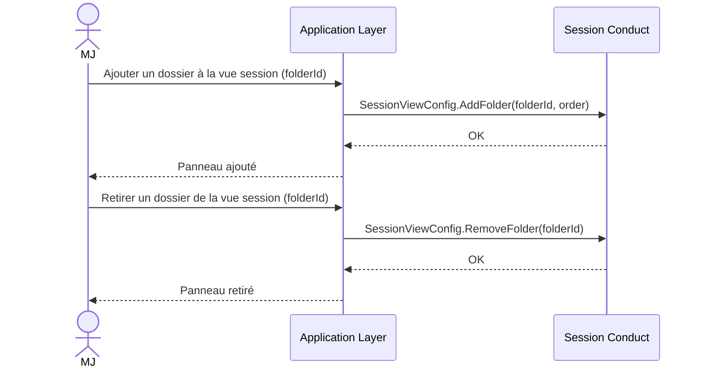
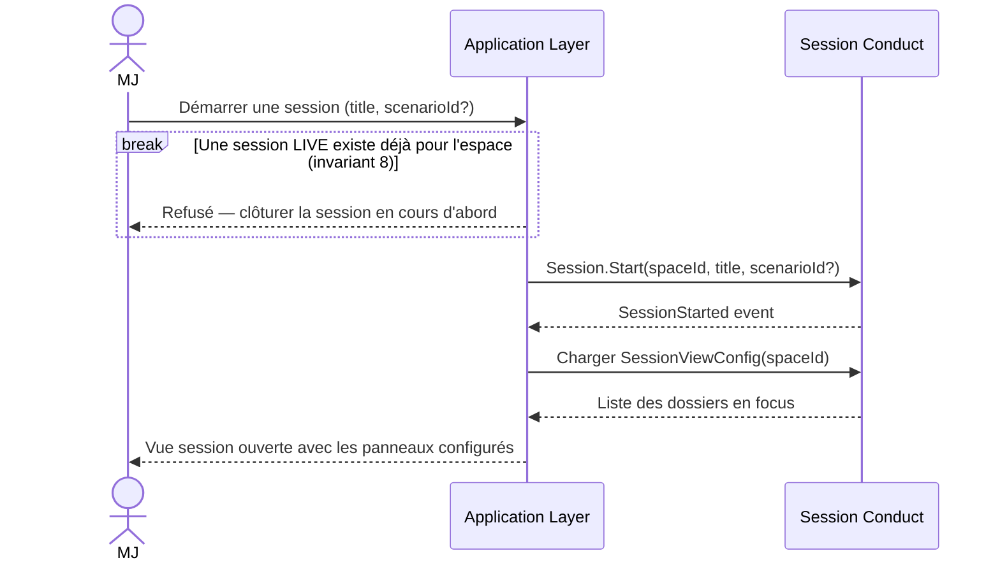
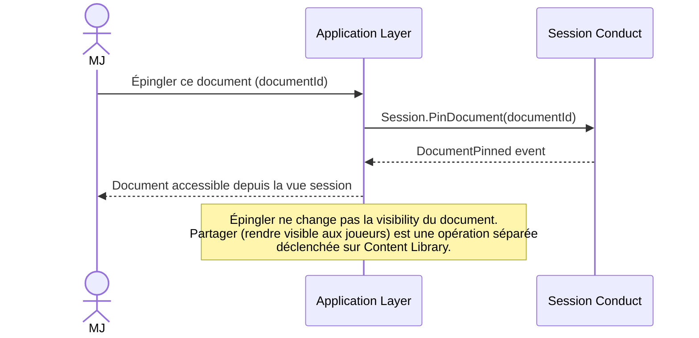
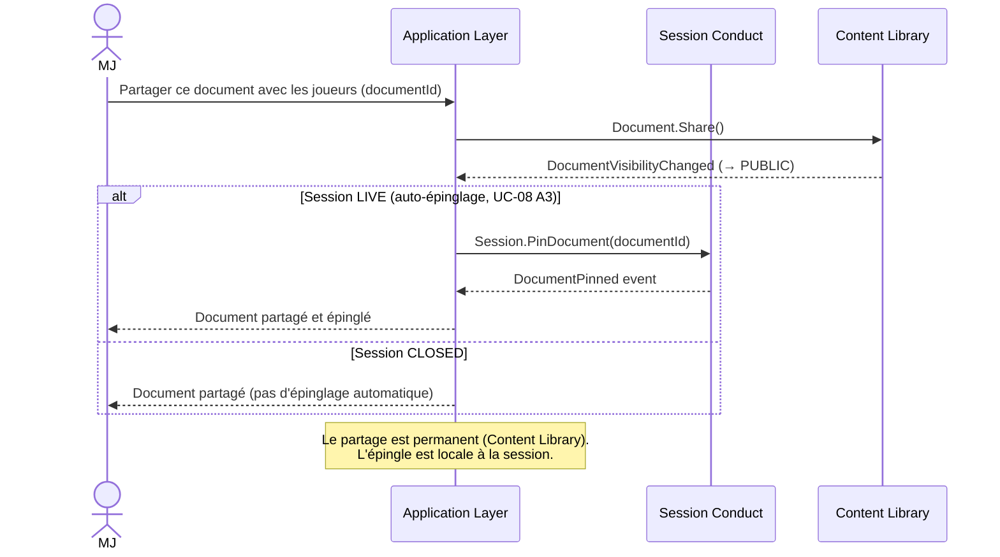
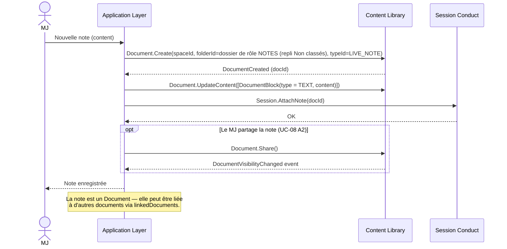
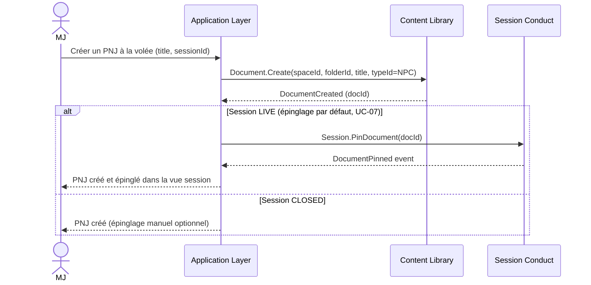
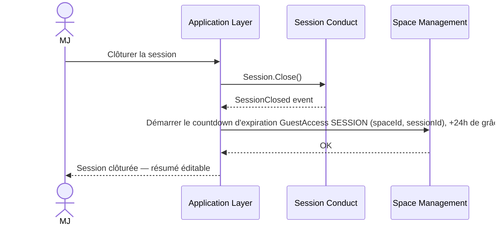
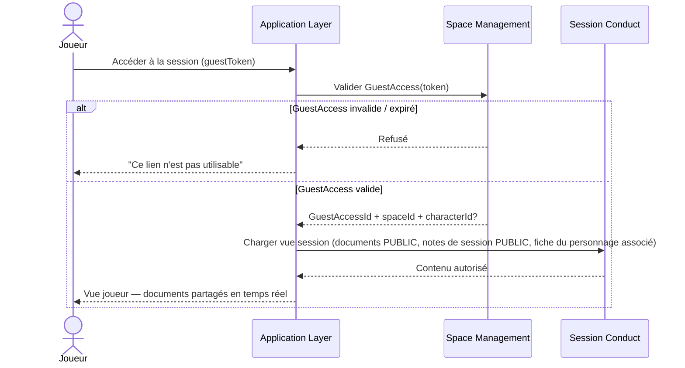

# Session Conduct — Diagrammes de flux

## Flux 1 — Initialisation de SessionViewConfig à la création d'espace

## Flux 2 — Configurer les panneaux de la vue session

## Flux 3 — Démarrer une session

## Flux 4 — Épingler un document en session

## Flux 5 — Partager un document depuis la vue session

## Flux 6 — Créer une note de session

## Flux 7 — Création à la volée en session (UC-07)

## Flux 8 — Clôturer une session

## Flux 9 — Accès joueur à la session (sans compte)

