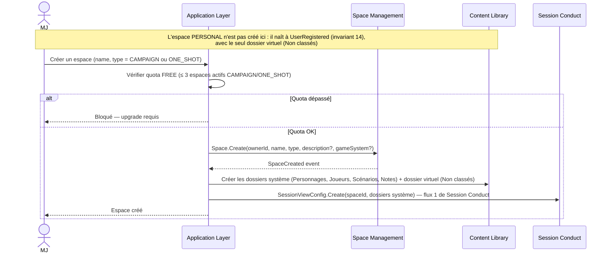
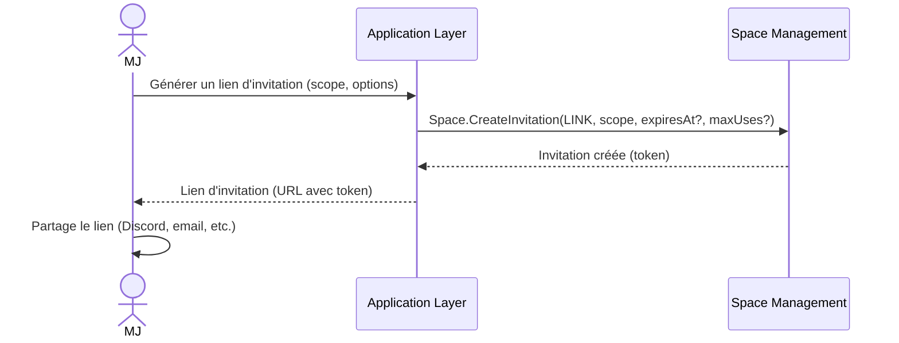
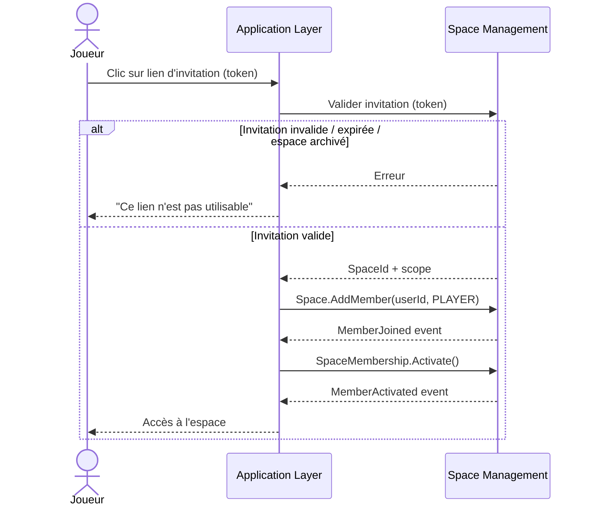
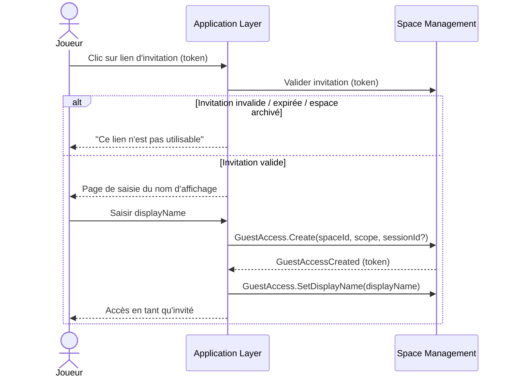
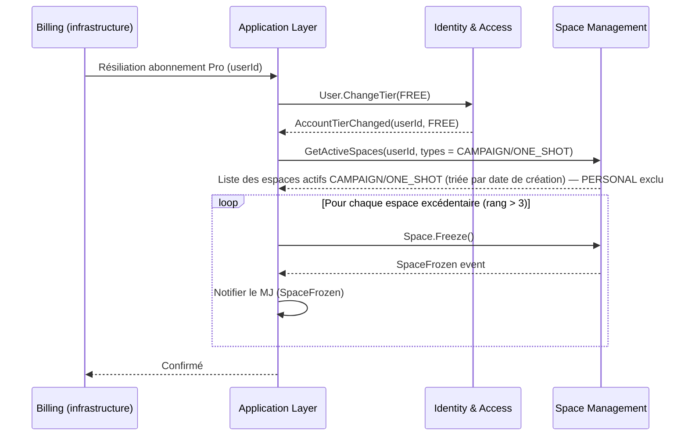
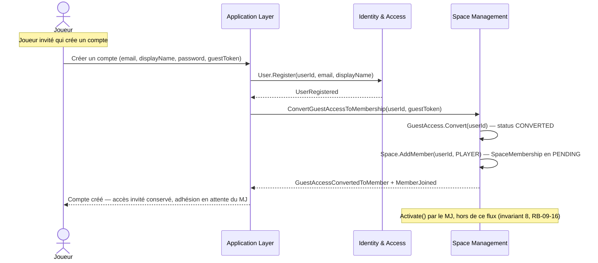
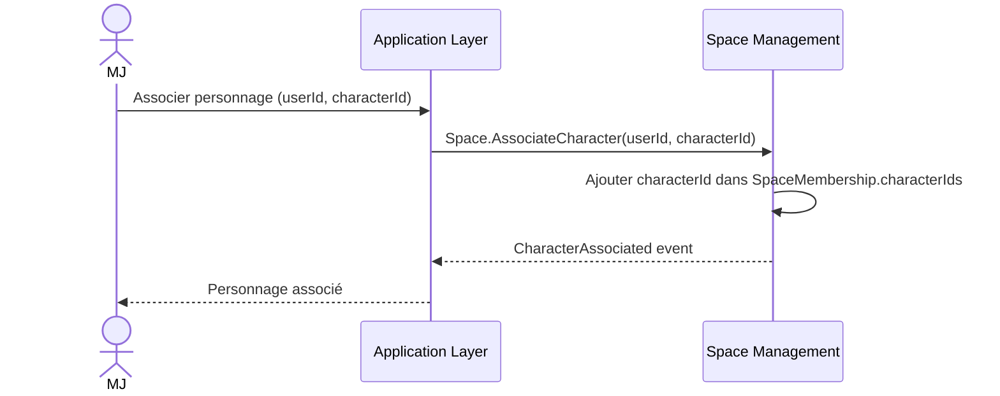

# Space Management — Diagrammes de flux

## Flux 1 — Créer un espace

## Flux 2 — Inviter un joueur (via lien)

## Flux 3 — Rejoindre via invitation — utilisateur connecté

## Flux 4 — Rejoindre en tant qu'invité (sans compte)

## Flux 5 — Gel des espaces excédentaires (downgrade PRO → FREE)

## Flux 6 — Conversion GuestAccess → SpaceMembership

## Flux 7 — Associer un personnage à un membre

